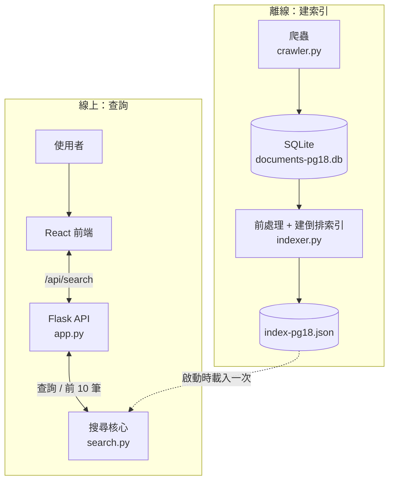
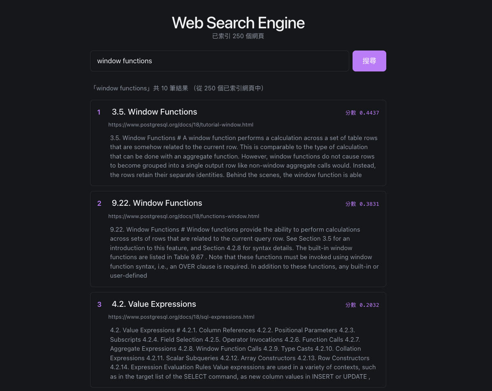
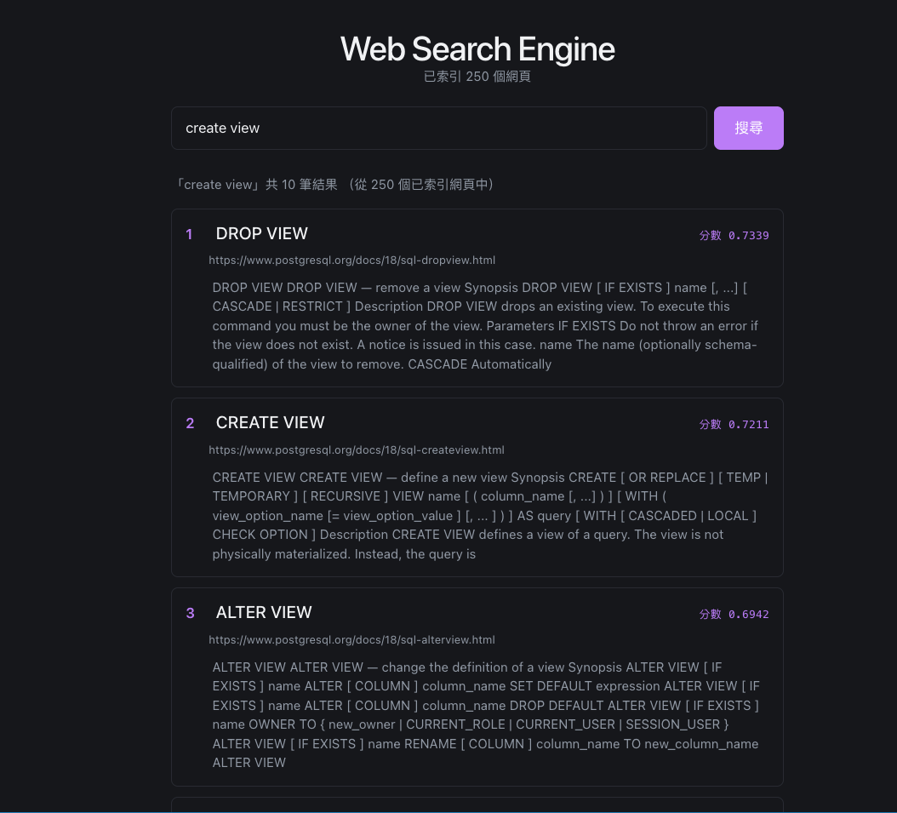
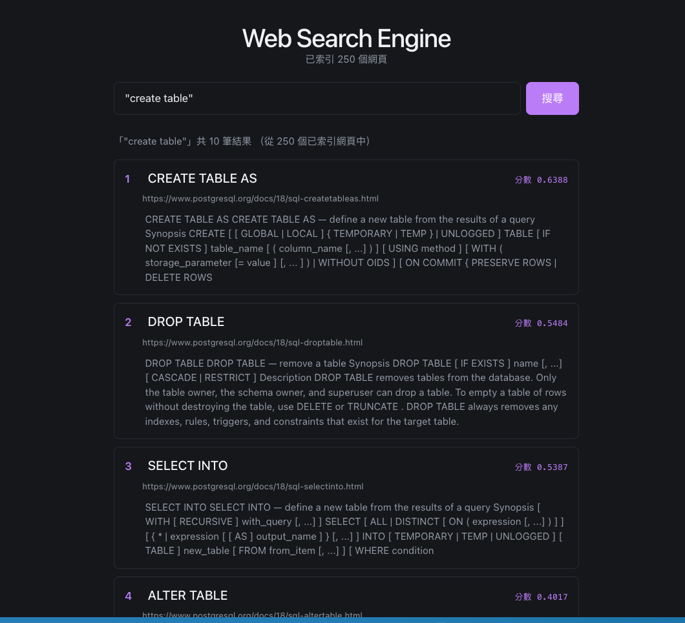
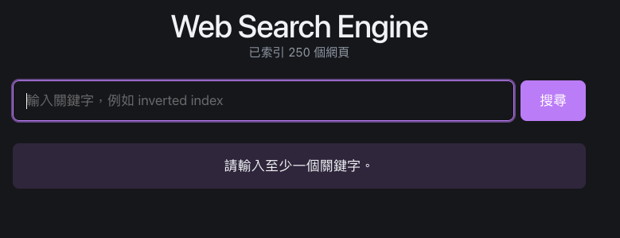

# 系統架構



整個系統分成離線和線上兩段。

離線這段：爬蟲把 PostgreSQL 18 文件爬下來，存進 SQLite；`indexer.py` 再從資料庫讀出文件，做前處理、建倒排索引，存成 `data/index-pg18.json`。

線上這段：Flask 啟動時把索引整份讀進記憶體，之後所有查詢都只用這份索引，不會再去爬網頁、重建索引或重算 IDF。使用者在 React 搜尋框輸入關鍵字，前端呼叫 `GET /api/search?q=...`，Flask 交給搜尋核心 `SearchIndex.search()`，核心用和文件相同的前處理處理查詢，找出候選文件、算 TF-IDF 餘弦相似度，取前 10 名。API 把標題、網址、摘要和分數回傳，前端依分數由高到低列出，上方顯示已索引頁數（250 頁）。

API 的回應：查詢成功回 200（沒命中就是空陣列）；空白或沒帶 `q` 回 400；索引還沒載入回 503。

| 模組 | 做什麼 |
| --- | --- |
| `crawler.py`、資料庫 | 爬取與儲存 |
| `preprocess.py`、`indexer.py` | 前處理、建索引 |
| `search.py`、`app.py` | 排序與 API |
| `code/frontend` | 搜尋頁面 |
| `evaluation/` | 評估 |

# 爬取統計

說明爬取範圍，列出嘗試次數、有效網頁數、涵蓋的主機、失敗次數與每頁平均文字大小，並標明計算單位。

# 文字前處理與評分方式

## 前處理

文件和查詢用同一套前處理：

- 全部轉小寫。
- 用 `[a-z0-9_]+` 斷詞，所以 `machine-learning` 會切成 `machine` 和 `learning`。
- 用一份英文停用詞清單去掉停用詞。清單裡沒有 `not` 和 `no`，因為它們會改變意思。
- 標題和內文一起索引。

## 索引與權重

倒排索引記的是「每個詞出現在哪些文件、各出現幾次」，另外記每個詞出現在幾頁（df）。這次是 250 頁、8,087 個詞。

- TF 直接用出現次數。
- IDF = ln((N + 1) / (df + 1)) + 1，N 是文件總數。分子分母各加 1 是怕 df 變成 0，最後加 1 讓每個詞的 IDF 至少是 1。
- 詞的權重 = TF × IDF。每頁的向量長度在建索引時先算好存起來，查詢時就不用再算。

## 查詢時怎麼算分數

只看出現在索引裡的查詢詞。先用倒排索引找出有包含查詢詞的文件，其他文件直接跳過，再對這些候選文件算餘弦相似度：

```
分數 = 向量內積 ÷ (查詢向量長度 × 文件向量長度)
```

依分數排序，最多回傳 10 筆。


# 搜尋範例

以下是 demo 搜尋頁面的五個例子，畫面上方都會顯示「已索引 250 個網頁」。

## 範例 1：`window functions`

想找的是 Window Functions 的說明。



前兩名就是兩篇 Window Functions：第 1 名是教學章節（3.5，分數 0.4437），第 2 名是函式清單（9.22，分數 0.3831）。第 3 名是 4.2 Value Expressions，分數降到 0.2032，因為文中只是提到 window function calls。

## 範例 2：`create view`

想找的是 CREATE VIEW 的說明。



前三名都是 VIEW 相關的指令頁：DROP VIEW（0.7339）、CREATE VIEW（0.7211）、ALTER VIEW（0.6942）。想找的 CREATE VIEW 排第 2，被 DROP VIEW 小幅超過。這幾頁都大量出現 `view` 這個詞，TF-IDF 分不出誰才是在講「怎麼建立」。

## 範例 3：`"create table"`（片語搜尋）

想找內文裡 `create table` 連在一起出現的頁面。



整個查詢用雙引號包起來，後端會要求詞依序相鄰才算命中。結果第 1 名是 CREATE TABLE AS（0.6388），接著是 DROP TABLE（0.5484）、SELECT INTO（0.5387）、ALTER TABLE（0.4017）。

## 範例 4：沒有結果的查詢 `zzzzqx`


索引裡沒有這個詞，顯示 0 筆結果，頁面提示「找不到符合「zzzzqx」的結果，請換個關鍵字再試試。」後端這時回的是 200 加空陣列，不是錯誤。

## 範例 5：空白查詢



搜尋框空白就按搜尋，前端會直接提示「請輸入至少一個關鍵字。」，不會把請求送到後端。

# 搜尋品質評估

評估的是 `data/index-pg18.json`（250 頁、8,087 個詞）。10 個查詢是先固定好的（`queries.json`，狀態是 frozen），不會看到結果不好再回頭改。每個查詢取前 5 名，逐筆人工標相關（1）或不相關（0）。判斷的標準是：頁面主要在談這個需求才算相關，只是在語法列表或內文順帶提到查詢詞的，不算。每一筆都有寫理由（`judgments.csv`）。

Precision@5 就是前 5 名裡相關的頁數除以 5，每題算一次，再對 10 題取平均。`run_info.json` 記了索引檔和查詢檔的 sha256，只要這兩個檔案沒變，就能重現同樣的結果。

| 題號 | 查詢 | 相關 / 5 | P@5 |
| --- | --- | ---: | ---: |
| q01 | window functions | 2 / 5 | 0.40 |
| q02 | recursive common table expressions | 1 / 5 | 0.20 |
| q03 | transaction isolation levels | 2 / 5 | 0.40 |
| q04 | explicit table locks | 1 / 5 | 0.20 |
| q05 | how to get inserted rows back | 0 / 5 | 0.00 |
| q06 | array functions and operators | 1 / 5 | 0.20 |
| q07 | create view | 1 / 5 | 0.20 |
| q08 | reclaim storage from dead rows | 2 / 5 | 0.40 |
| q09 | sort rows order by | 1 / 5 | 0.20 |
| q10 | retry after serialization failure | 1 / 5 | 0.20 |
| | **平均** | | **0.240** |

分數分布是 3 題 0.40、6 題 0.20、1 題 0.00。每題的前 5 名清單在 `backend/evaluation/review.md`。

要注意的是，只有 10 題、每題只看前 5 名，每題 P@5 最小單位就是 0.20，所以這個分數看大概趨勢可以，不適合拿來下精確的結論。

## BM25 比較

想看換掉排序公式會不會比較好，所以在同一份索引、同樣的 10 題和標註規則下，只把 TF-IDF 餘弦換成 BM25（k1 = 1.2、b = 0.75），前處理和倒排索引都不動。BM25 一樣看詞頻，但同一個詞重複出現，後面每多一次加分會越來越少，也會把文件長度算進去（這 250 頁平均 816.768 詞）。

| 題號 | 查詢 | TF-IDF P@5 | BM25 P@5 | 差值 |
| --- | --- | ---: | ---: | ---: |
| q01 | window functions | 0.40 | 0.40 | 0.00 |
| q02 | recursive common table expressions | 0.20 | 0.20 | 0.00 |
| q03 | transaction isolation levels | 0.40 | 0.40 | 0.00 |
| q04 | explicit table locks | 0.20 | 0.40 | +0.20 |
| q05 | how to get inserted rows back | 0.00 | 0.00 | 0.00 |
| q06 | array functions and operators | 0.20 | 0.00 | −0.20 |
| q07 | create view | 0.20 | 0.20 | 0.00 |
| q08 | reclaim storage from dead rows | 0.40 | 0.60 | +0.20 |
| q09 | sort rows order by | 0.20 | 0.00 | −0.20 |
| q10 | retry after serialization failure | 0.20 | 0.20 | 0.00 |
| | **平均** | **0.240** | **0.240** | **0.000** |

兩種方法的平均 P@5 一樣都是 0.240。q04、q08 各多 1 篇相關頁面，q06、q09 各少 1 篇，剛好抵銷，其他 6 題相同。

- q04（+0.20）：BM25 的第 5 名多了 `LOCK` 指令頁，裡面有 `LOCK TABLE` 的語法、表鎖模式和 `NOWAIT`，所以算相關。
- q06（−0.20）：TF-IDF 的第 1 名是 Arrays，到了 BM25 掉到第 9 名。BM25 排第 1 的是 JSON Functions and Operators，它也有 `array`、`functions`、`operators` 這些字，但講的是 JSON 陣列，不是要找的原生陣列，所以不算相關。

只有 10 題、一份文件快照，所以這個結果只能說明換成 BM25 後排名怎麼變，還看不出是 IDF、詞頻、文件長度哪一項影響最大。BM25 只用在評估（`search_bm25()`），網頁搜尋仍然是 TF-IDF。

## 查詢時間

計時範圍：`SearchIndex.search(query, top_k=10)`，從收到查詢字串開始，到回傳前 10 筆結果（標題、網址、摘要）為止。索引載入、資料庫、Flask / HTTP 和前端都不算。

方法：用一樣的 10 個查詢，每個先暖機 3 次（不計入），再計時 50 次，共 500 筆。用 `time.perf_counter_ns()` 計時，計時期間暫停垃圾回收。

| 平均 | 中位數 | 標準差 | 最小 | p95 | p99 | 最大 |
| --- | --- | --- | --- | --- | --- | --- |
| 0.490 ms | 0.516 ms | 0.259 ms | 0.127 ms | 1.007 ms | 1.169 ms | 1.242 ms |

索引載入只在啟動時做一次，大約 20.0 ms。

這只是搜尋核心的時間，不是使用者實際看到的延遲。數字是在單一環境（macOS arm64、Python 3.14.9、250 頁）量的，換機器會不一樣。要重跑就在 `code/backend` 執行 `python -m evaluation.measure_latency`。

# 表現不佳的查詢分析

下面的「可能原因」是對照標註和索引統計（df、idf）推測的，沒有另外做拿掉單詞再比較的實驗。

## q05：how to get inserted rows back（P@5 = 0.00）

- 想找的：INSERT / UPDATE / DELETE 的 `RETURNING` 子句。
- 實際結果：前 5 名是 SELECT、Data Manipulation 章節、ROLLBACK PREPARED 這類頁面，只是剛好有 rows、inserted 之類的字，分數都很低（最高 0.1116）。
- 可能原因：查詢裡沒有 `returning` 這個詞。前處理後剩下 how、get、inserted、rows、back，都是常見詞（df 27 到 78 頁）。詞袋模型不知道「get inserted rows back」指的是 `RETURNING`，這是詞彙不一致，不是程式寫錯。
- 可以怎麼改：做查詢擴充或同義詞對應（例如把 inserted rows back 對到 returning），或是加語意向量檢索來補。

## q02：recursive common table expressions（P@5 = 0.20）

- 想找的：`WITH` / `WITH RECURSIVE` 的說明。
- 實際結果：第 1 名是對的（7.8 WITH Queries，0.2019），但第 2 到 5 名是 DROP TABLE、CREATE TABLE AS、Indexes on Expressions、SELECT INTO，分數只差一點點（0.18 到 0.19）。
- 可能原因：`table` 出現在 133 頁、`expressions` 出現在 37 頁，都是通用詞，很多語法頁因為這兩個字出現很多次而累積出接近的分數；真正有區別力的 `recursive` 只出現在 15 頁。原始詞頻沒有飽和處理，通用詞一直重複就一直加分。
- 可以怎麼改：加詞頻飽和（BM25 就是這個方向）。不過實測 BM25 在這題的 P@5 還是 0.20，只是前 5 名組成不一樣。另一個方向是提高標題命中的權重。

# 實作挑戰

##　劉柏均（後端、ＡＰＩ串接）
### 1. 串接：正式索引還沒好，怎麼先測 API
一開始正式索引還沒產出，如果 API 直接依賴索引檔，就得等資料和索引都準備好才能測。我把 Flask 路由和搜尋核心拆開，先用固定的搜尋結果測 `/api/search` 的回傳格式，再從爬蟲的 SQLite 資料建立暫時的記憶體索引，拿實際文件測查詢。正式索引就緒後，改成在 Flask 啟動時載入離線索引，前端還是呼叫同一個端點。這樣可以先確認串接有沒有問題，正式展示時也不用每次查詢都重建索引。

### 2. 搜尋排序：有回傳結果，不代表分數算對
API 回傳 `200` 只能確認請求有成功，光看前端列出的結果，也很難發現 TF-IDF 權重或餘弦相似度算錯。我用 3 篇短文件做一份可以手算的小索引，透過 Flask 測試客戶端送出 `SQL` 和 `sql sql join`，直接核對回傳的名次和分數。也另外測了查不到和沒有輸入這兩種情況：查不到回 `200` 和空陣列，空白查詢回 `400`。這些測試能確認排序和 API 回應符合預期；搜尋結果對使用者有沒有幫助，則另外用人工標註和 Precision@5 評估。

## 陳稜瑾（索引、前端、評估）

### 1. 評估：分數低的查詢不能直接改
查詢集在標註前就先凍結，所以 q05（how to get inserted rows back）前 5 名一個相關的都沒有時，不能把查詢改掉重跑。我逐筆看前 5 名，發現文件中講這個功能的頁面都用 RETURNING，而查詢裡沒有這個字，推測是詞彙對不上。處理方式是查詢集不動，把這個結果和推測的原因寫進「表現不佳的查詢分析」。這個原因我們沒有拿掉單詞再比較來驗證，所以報告裡寫的是「可能」。

### 2. 查詢時間：要先決定量什麼
一開始要決定計時範圍。如果把 Flask 和前端都算進去，量到的就不只是搜尋本身，所以最後只量 `SearchIndex.search()`，從收到查詢字串到回傳前 10 筆。每個查詢先暖機 3 次，再量 50 次，共 500 次，計時期間暫停垃圾回收。結果平均約 0.49 毫秒。因為只有 250 頁，數字很小，報告裡有註明這只代表搜尋核心，不含網路和前端。

# 組員貢獻

| 組員 | 負責的工作 |
| --- | --- |
| 劉柏均（M1155515） | 索引、搜尋排序、Flask API 後端、延伸資料庫資料、片語搜尋 |
| 陳稜瑾（M1155518） | 前處理、索引、前端網頁、評估（查詢集、人工標註、P@5、查詢時間） |
| 陳昶亨（M1155505） | 爬蟲、資料庫 |


# 個人心得

## 劉柏均
這次專題我覺得一大困難點在於，爬蟲、索引、搜尋和前端雖然可以分開做，但接起來之前要先講清楚每一段會收到什麼、回傳什麼。我主要負責搜尋排序和 Flask API。後端對我來說比較熟悉，所以我先用固定的結果確認 API 回傳的格式，等爬蟲有資料後，再用 SQLite 裡的文件做一份暫時的索引來測。這樣正式索引還在做的時候，我也能先驗證查詢流程。

搜尋排序是我這次花比較多時間理解的部分。課堂上看 TF-IDF 和餘弦相似度的公式時，覺得照著算就好，實際寫才發現，前端能列出結果，光看畫面還是很難判斷分數有沒有算對。我用三篇短文件做測試，先手算預期的分數和名次，再和 API 回傳的結果比對。做完之後，我比較能把課堂上的公式和實際的搜尋結果連起來，也更清楚該怎麼分別驗證分數算得對不對，以及排在前面的文件是否真的符合使用者的需求。

## 陳稜瑾
這次專題讓我覺得整個搜尋系統比想像中複雜，從爬資料、建索引、排序到前端和評估，一個人做的話會花很多時間。有同學一起分擔，工作量少了很多。我們分工也有大致照各自擅長的部分分配。

我負責前端、索引和評估。前端對我來說比較好上手，因為大學時就是主修這一塊，串接 API 也不難。索引和評估則是我第一次做，一開始比較怕做錯，例如 IDF 的算法、評估的標註有沒有偏掉。做完之後才比較有把握，也知道目前的 P@5 只有 0.240，只用 10 題、一個人標註，還是有限制。


## 陳昶亨


